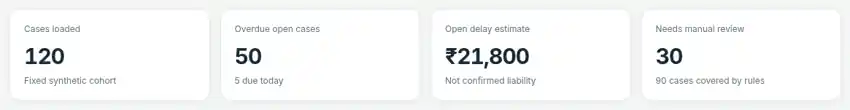
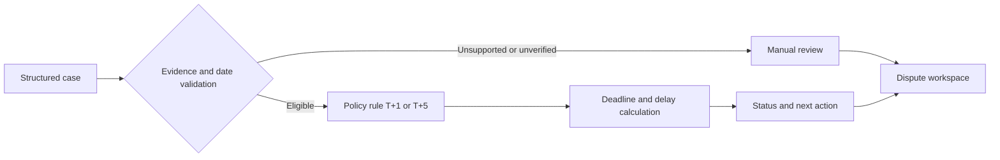
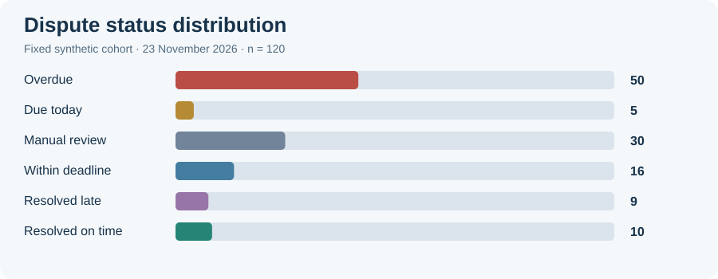
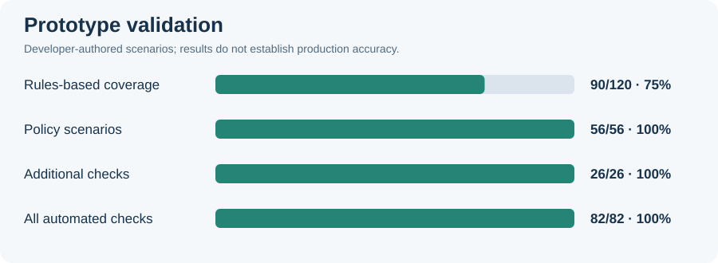

# PayResolve

### A rules-based UPI dispute triage workspace for payment operations teams

An independent, 0-to-1 product management project exploring how payment operations teams can identify failed UPI transactions that need attention, determine applicable reversal deadlines and make explainable triage decisions.

**FinTech · B2B SaaS concept · Working MVP v2 · HTML / CSS / JavaScript**

`120 synthetic cases` · `75% demo coverage` · `82/82 automated checks` · `4 payment platforms benchmarked`

[Product case study & PRD](CASE_STUDY.md) · [Validation report](TEST_RESULTS.txt) · [Scenario benchmark](BENCHMARK.csv) · [Run locally](#run-locally)



*Cropped screenshot of the actual application KPI cards. All transaction records and compensation estimates are synthetic.*

## The problem

When a UPI payment is debited but not completed, the applicable reversal timeline depends on the failure category. Payment operations analysts need to identify the correct rule, check evidence, recognise overdue cases and recommend the next action. PayResolve explores whether bringing those decisions into a single workspace can reduce manual triage effort and improve consistency.

The opportunity is based on secondary research into RBI's failed-payment framework, NPCI's UPI ecosystem and four existing payment products: PhonePe, Google Pay, NPCI MyUPI and Razorpay. The workflow assumptions and commercial opportunity still need direct validation with operations teams.

## Product discovery and competitive positioning

| Reference product | Observed capabilities | Product implication |
| --- | --- | --- |
| PhonePe | Consumer grievances and escalation | Do not duplicate existing consumer support |
| Google Pay | Payment troubleshooting and support | Make the next action easy to understand |
| NPCI MyUPI | Cross-app grievance tracking and AI assistance | Focus on an analyst workspace rather than another consumer chatbot |
| Razorpay | Merchant payment, refund and dispute operations | Integrate with existing operational workflows instead of replacing them |

These observations are from public documentation linked below, not a confirmed market gap. PayResolve tests the narrower positioning of evidence-aware, auditable triage.

## Product strategy

| | Decision |
| --- | --- |
| Primary user | Payment operations or dispute support analyst |
| Buyer | Head of Payment Operations |
| Job to be done | Identify which cases need attention, why, and what action to take next |
| Positioning | Read-only, explainable decision support alongside existing payment systems |
| MVP priority | Reliable rules, evidence validation, prioritised queue and operational visibility |
| Pilot success metric | Median time to correctly triage a dispute |
| Guardrails | Correct deadlines, safe handling of unsupported cases, no unauthorised financial actions |

The MVP uses deterministic rules, not generative AI, for financial calculations. MoSCoW prioritisation keeps the first release focused on triage while deferring live integrations, automated refunds and AI-assisted text classification.

### Prioritisation and trade-offs

| MoSCoW priority | Scope | Rationale |
| --- | --- | --- |
| Must have | Policy engine, evidence checks, queue, dashboard, simulator and export | Establish triage correctness and a demonstrable workflow |
| Should have | Case import, audit history and ownership | Support a future operations pilot |
| Could have | AI-assisted classification with human review | Extract structured information from complaints without handing financial decisions to an LLM |
| Won’t have in this MVP | Live bank APIs or automatic refunds | Avoid integration, privacy and financial-action risk |

## Product walkthrough

### 1. Dispute queue

Filter by status or payment type, search by case ID and export the filtered results. Cases are ordered by status and indicative delay amount so an analyst can review overdue transactions first.

See the status distribution chart in [Validation and results](#validation-and-results).

### 2. Explainable case inspection

Each case shows its dates, outcome, applicable policy, calculation and suggested next action. Incomplete or unsupported evidence is flagged for manual review instead of generating a misleading amount.

Each case includes the rule reference, evidence checks and traceable calculation.

### 3. Interactive policy simulator

Change the transaction type, dates, outcome and evidence to explore boundary conditions. Simulation inputs do not alter the underlying demo cohort.

Try the simulator in `index.html` using the local setup below.


## Regulatory logic

The MVP models two specific domestic failed-UPI categories in RBI's [20 September 2019 TAT circular, Annex 4(a) and 4(b)](https://www.rbi.org.in/Scripts/BS_CircularIndexDisplay.aspx?Id=11693).

| Covered category | Outer time limit | Indicative delay rate |
| --- | --- | --- |
| Fund transfer: account debited, beneficiary not credited | T + 1 calendar day | ₹100 per day beyond the limit |
| Merchant payment: account debited, merchant confirmation missing | T + 5 calendar days | ₹100 per day beyond the limit |

`T` is the transaction calendar date. The engine validates evidence, determines the applicable deadline, and calculates elapsed overdue days up to the review date or confirmed resolution date. Applicable compensation is proactive under the cited circular; the prototype does not establish liability or execute compensation.



## Validation and results

The following results are reproducible on the fixed **23 November 2026** demo snapshot. They describe prototype test performance, not production results.

| Metric | Result | Evidence |
| --- | ---: | --- |
| Automated checks passed | **82 / 82** | [Test log](TEST_RESULTS.txt) |
| Policy scenarios passed | **56 / 56** | [Expected vs actual](BENCHMARK.csv) |
| Additional validation checks passed | **26 / 26** | [Test harness](test.js) |
| Synthetic cases processed | **120** | [Fixed dataset](DEMO_DATA.json) |
| Rules-based coverage | **75% (90 / 120)** | Supported, verified demo cases |
| Manual-review cases | **30** | Unverified or unsupported cases |
| Overdue open cases | **50** | Demo snapshot |
| Indicative open delay estimate | **₹21,800** | 218 cumulative overdue days × ₹100 |
| Browser smoke-check groups | **8 / 8** | [Browser verification](BROWSER_TEST_RESULTS.txt) |

The policy scenario expectations are developer-authored against the cited circular, not independently certified. The coverage figure depends on how the synthetic cohort was constructed. The delay estimate is neither actual compensation owed nor money saved.

### Measured demo workflow





The six status counts reconcile to 120. Manual review accounts for 25% of this deliberately constructed cohort; it is a safety outcome, not an error rate.

### Next evaluation

A small comparative usability study will measure time and correctness for manual rule lookup versus the PayResolve workflow. The proposed pilot goal is a 30% reduction in median correct triage time; this is a target, not an achieved result. The [research template](USER_RESEARCH.csv) is blank pending data collection.

| Proposed pilot metric | Measurement | Target (not achieved) |
| --- | --- | ---: |
| Median correct triage time | Timed comparison of comparable manual and assisted tasks | 30% lower |
| Correct deadline calculation | Expected vs actual on independently reviewed test cases | 100% |
| Task completion | Completed correctly / assigned tasks | 90% |
| Incorrect numeric estimates for unsupported cases | Incorrect estimates / unsupported cases | 0% |
| Unauthorised financial actions | Count of financial actions performed | 0 |

Use a counterbalanced comparison, retain raw time and correctness data, and report the participant count. Any operational ROI estimate should follow observed time savings; it must not use the synthetic INR 21,800 as money saved.

## Run locally

No API key, account, backend or package installation is needed to use the demo.

1. Download or clone this repository.
2. Open `index.html` in Safari or Chrome.
3. If the browser blocks local files, open Terminal in the repository folder and run:

```bash
python3 -m http.server 8000
```

Then open [http://localhost:8000](http://localhost:8000).

### Reproduce the automated checks

With Node.js installed, run the following in the repository folder:

```bash
node test.js
```

The test harness uses Node's built-in assertion library and regenerates `BENCHMARK.csv` and `DEMO_DATA.json`. No npm dependencies are needed.

### Publish on GitHub Pages

In the repository, open **Settings → Pages → Deploy from a branch → main → / (root)**. Save and confirm the deployed URL works before sharing it. This project uses a static entry point at `index.html`.

## Repository structure

```text
payresolve/
├── index.html               # Application structure
├── style.css                # Responsive interface
├── app.js                   # Dashboard, queue, simulation and export
├── engine.js                # Policy validation and business logic
├── test.js                  # Automated scenario and boundary checks
├── DEMO_DATA.json            # Reproducible synthetic cohort
├── BENCHMARK.csv             # Expected vs actual policy scenarios
├── TEST_RESULTS.txt          # Automated validation log
├── BROWSER_TEST_RESULTS.txt  # Browser smoke-test report
├── CASE_STUDY.md             # Product research, strategy and PRD
├── USER_RESEARCH.csv         # User validation template
└── assets/                  # Application KPI screenshot and data charts
```

## Roadmap

| Stage | Scope |
| --- | --- |
| V2 — completed | Evidence checks, deadline calculation, prioritised queue, filtering, export, simulator and validation |
| Next | Independent policy review, analyst interviews, usability benchmark, structured imports and audit history |
| Later | Permissions, persistent storage, optional AI-assisted classification and authorised payment integrations |

## Research references

- [RBI: Harmonisation of turnaround time for failed transactions](https://www.rbi.org.in/Scripts/BS_CircularIndexDisplay.aspx?Id=11693) (20 September 2019)
- [RBI: Online Dispute Resolution system](https://m.rbi.org.in/Commonman/English/Scripts/Notification.aspx?Id=3194) (6 August 2020)
- [NPCI: UPI product statistics](https://www.npci.org.in/product/upi/product-statistics?financialYear=2026-27)
- [PhonePe grievance policy](https://www.phonepe.com/grievance-policy/)
- [Google Pay payment support](https://support.google.com/pay/india/answer/9494510?hl=en-GB)
- [NPCI MyUPI](https://www.npci.org.in/product/myupi.html)
- [Razorpay payment dashboard](https://razorpay.com/docs/payments/payments/dashboard/) and [dispute guide](https://razorpay.com/dispute-guide/)

## Limitations and responsible use

This is an AI-assisted, independent portfolio MVP. It is not a banking product, a compliance certification or financial advice. No real customer information, payment credentials, live bank connection or financial actions are involved. User adoption, business impact and independent regulatory validation have not been established. The screenshot and browser checks use embedded copies of the exact application assets because direct navigation was restricted in the test environment. Before any real-world use, the rules require current-policy verification and domain, security and legal review.
